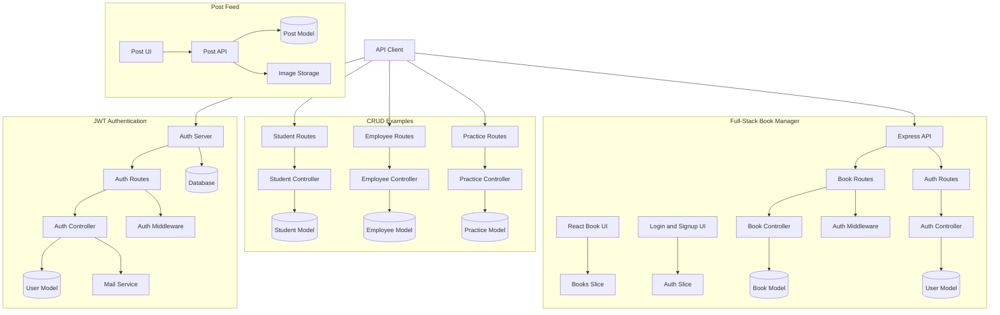

# Complete Backend Development

A collection of backend and full-stack development projects built using Node.js, Express.js, MongoDB, React, Redux Toolkit, JWT Authentication, and other web technologies.

This repository contains practical examples of authentication, CRUD operations, REST APIs, protected routes, state management, and image uploads.

## 📌 Table of Contents

- [About the Project](#-about-the-project)
- [Projects Included](#-projects-included)
- [Tech Stack](#-tech-stack)
- [Project Architecture](#-project-architecture)
- [Getting Started](#-getting-started)
- [Environment Variables](#-environment-variables)
- [Key Features](#-key-features)
- [Learning Objectives](#-learning-objectives)
- [Repository Structure](#-repository-structure)
- [Author](#-author)

## 🚀 About the Project

**Complete Backend Development** is a learning repository containing multiple projects and examples that demonstrate how frontend applications communicate with backend APIs.

The repository covers backend fundamentals, authentication, database operations, route handling, middleware, and full-stack application development.

Each project focuses on a specific concept and can be explored independently.

## 📂 Projects Included

### 1. JWT Authentication

**Folder:** `auth-jwt/`

Demonstrates user authentication and protected API routes using JSON Web Tokens.

Features:
- Authentication routes and controllers
- User model and database connection
- JWT authentication middleware
- Email service integration
- Protected endpoint handling

[Explore JWT Authentication](https://github.com/buildwithsachin02/complete-backend/tree/main/auth-jwt)

### 2. Student CRUD

**Folder:** `student-crud/`

A backend project demonstrating CRUD operations for student records.

Features:
- Create student records
- Read student records
- Update student records
- Delete student records
- Route and controller separation

[Explore Student CRUD](https://github.com/buildwithsachin02/complete-backend/tree/main/student-crud)

### 3. Employee CRUD

**Folder:** `employe-crud/`

A practical example of managing employee records through backend routes and controllers.

Features:
- Employee routes
- Employee controllers
- Employee model
- CRUD request handling

[Explore Employee CRUD](https://github.com/buildwithsachin02/complete-backend/tree/main/employe-crud)

### 4. Practice CRUD

**Folder:** `practice_01/`

A practice project for understanding Express routes, controllers, models, and database operations.

[Explore Practice CRUD](https://github.com/buildwithsachin02/complete-backend/tree/main/practice_01)

### 5. Full-Stack Book Manager

**Folder:** `fullstack-crud-app/`

A full-stack application combining a React frontend with a backend API.

Features:
- Book management UI
- Login and signup pages
- Redux Toolkit state management
- Book and authentication slices
- Express API routes and controllers
- Authentication middleware
- Book and user models

[Explore Book Manager](https://github.com/buildwithsachin02/complete-backend/tree/main/fullstack-crud-app)

### 6. Post Feed and Image Upload

**Folder:** `post-data-crud/`

A project demonstrating post-related API operations and image storage integration.

Features:
- Post feed interface
- Backend API
- Post model
- Image upload service

[Explore Post Feed](https://github.com/buildwithsachin02/complete-backend/tree/main/post-data-crud)

## 🛠️ Tech Stack

The repository includes projects using the following technologies:

| Technology | Purpose |
|---|---|
| JavaScript | Application logic |
| Node.js | Backend runtime |
| Express.js | REST API development |
| MongoDB | Database for applicable projects |
| Mongoose | MongoDB object modeling |
| React | Frontend UI |
| Redux Toolkit | Frontend state management |
| JWT | Token-based authentication |
| Nodemailer | Email service integration |

*The exact technologies and dependencies may differ between individual projects. Check each project's `package.json` for its requirements.*

## 🏗️ Project Architecture

The following diagram illustrates the main modules and their relationships.



## ⚙️ Getting Started

### Prerequisites

Install the following tools before running a project:

- [Node.js](https://nodejs.org/)
- npm (included with Node.js)
- [Git](https://git-scm.com/)
- MongoDB, if required by the selected project
- Any additional services specified in that project's configuration

### 1. Clone the Repository

```bash
git clone https://github.com/buildwithsachin02/complete-backend.git
```

### 2. Open the Project Folder

```bash
cd complete-backend
```

### 3. Select a Project

Navigate into the folder you want to explore.

For example:

```bash
cd student-crud
```

### 4. Install Dependencies

Run this command in the selected project's directory:

```bash
npm install
```

### 5. Configure Environment Variables

Create a `.env` file using the variable names required by that project's code.

Example:

```env
PORT=5000
MONGO_URI=your_mongodb_connection_string
JWT_SECRET=your_secret_key
```

These are illustrative variables, not a guarantee that every project uses the same configuration. Check the project's source code before setting them.

### 6. Run the Project

Use the script defined in that project's `package.json`.

For example, if a `dev` script exists:

```bash
npm run dev
```

Otherwise, use the appropriate script documented by the project.

## 🔐 Environment Variables

Depending on the project, environment variables may include:

- `PORT` — backend server port
- `MONGO_URI` — MongoDB connection string
- `JWT_SECRET` — secret used to sign and verify JWTs
- Email service credentials
- Image storage configuration

**Security:** Never commit `.env` files, database credentials, email passwords, or JWT secrets to GitHub. Add sensitive files to `.gitignore`.

## ✨ Key Features

- REST API development
- CRUD operations
- User authentication
- JWT-based protected routes
- Route, controller, and model separation
- React and Redux Toolkit integration
- Database connectivity
- Email service integration
- Image upload and storage integration

Features vary by project.

## 🎯 Learning Objectives

This repository helps developers practice:

- Understanding the Node.js and Express.js request-response lifecycle
- Organizing backend code into routes, controllers, and models
- Building RESTful APIs
- Implementing JWT authentication middleware
- Performing database CRUD operations
- Connecting React applications to backend APIs
- Managing frontend state with Redux Toolkit
- Integrating external services into backend applications

## 📁 Repository Structure

```text
complete-backend/
├── auth-jwt/
├── student-crud/
├── employe-crud/
├── practice_01/
├── fullstack-crud-app/
│   ├── app/
│   └── backend/
└── post-data-crud/
    ├── app/
    └── backend/
```

*This is a simplified overview. Individual folders may contain additional files and subdirectories.*

## 👨‍💻 Author

**Sachin Yadav**

Full-Stack Web Developer

- GitHub: [@BuildWithSachin02](https://github.com/buildwithsachin02)
- Repository: [Complete Backend Development](https://github.com/buildwithsachin02/complete-backend)

---

If you find this repository useful for learning backend and full-stack development, consider giving it a ⭐ on GitHub.

**Happy Coding!**
